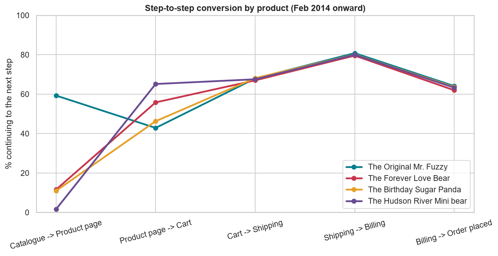
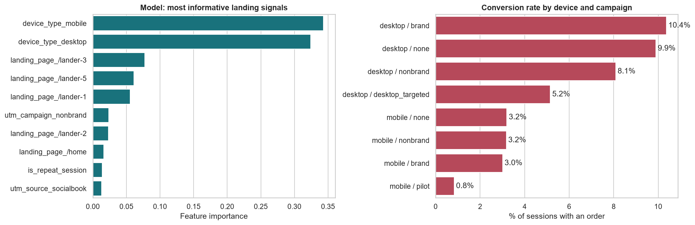

# Product Performance and Conversion Funnel Analysis

[](https://github.com/Haven-Pham/product-funnel-conversion-analysis/actions/workflows/ci.yml)


## Overview

An online stuffed-toy retailer sells four products and wants to know which ones earn their place and where shoppers
drop out on the way to an order. This project combines 40,025 order items, 1,731 refunds, 472,871 sessions and
1.19 million page views (March 2012 to March 2015) to measure product revenue after refunds, diagnose a six-step
purchase funnel for each product, and identify which traffic, at the moment it lands, is most likely to buy.

**Summary of results.** The Original Mr. Fuzzy earns 62% of net revenue, but its refund rate swings by quarter and
reached 10.6% in Q3 2014. Products separate at the first funnel step: 59% of catalogue visitors open Mr. Fuzzy,
against about 11% for the Love Bear and Sugar Panda. Once opened, though, the Love Bear converts to cart better
(56% vs 43%). Checkout conversion is the same for every product. Among landing signals, device dominates:
desktop sessions convert at 8–10%, mobile at about 3%.



## Business Questions

1. Which products generate the most revenue after refunds, and which have return problems?
2. Where in the purchase funnel does each product lose shoppers?
3. Which information available at landing predicts a purchase?

## Approach

- **Product performance.** Order items joined to products and refunds (one-to-one check). The analysis computes net
  revenue, refund rate, gross margin and Mr. Fuzzy's quarterly refund trend.
- **Fair funnel comparison.** The products launched between March 2012 and February 2014. The funnel therefore uses
  only sessions from 5 February 2014, when all four were on sale. A session counts at a step only if it also reached
  every earlier step: catalogue → product page → cart → shipping → billing → order.
- **Leakage-free purchase model.** A random forest uses only landing-time information: source, campaign, device,
  repeat visit, referrer and landing page. Page counts and cart or billing visits are excluded, because they occur on
  the way to the purchase and would leak the outcome.

## Key Findings

| Product | Net revenue | Share | Refund rate | Catalogue → page | Page → cart |
|---|---:|---:|---:|---:|---:|
| The Original Mr. Fuzzy | $1,149,220 | 62.0% | 5.1% | 59.3% | 42.9% |
| The Forever Love Bear | $339,963 | 18.3% | 2.2% | 11.6% | 55.8% |
| The Birthday Sugar Panda | $215,417 | 11.6% | 6.0% | 10.9% | 46.3% |
| The Hudson River Mini Bear | $148,570 | 8.0% | 1.3% | 1.6% | 65.1% |

- **Checkout is product-neutral.** Cart → shipping is 67–68%, shipping → billing 80–81%, billing → order 62–64% for
  every product.
- **The Love Bear's weak catalogue pull is real.** Restricting the comparison to the period when the product existed
  moves its click-through only from 10.0% to 11.6%.
- **Landing signals.** The model reaches a ROC-AUC of 0.63 on held-out sessions, a realistic level for landing-time
  data. Mobile sessions convert at about 3% in every campaign. The mobile pilot campaign converts at 0.8%.



## Recommendations

1. **Investigate Mr. Fuzzy refunds by date and supplier batch.** The flagship's refund spikes put the largest
   revenue line at risk.
2. **Raise the Love Bear and Sugar Panda's visibility** with catalogue placement, cross-links and bundles. Their
   bottleneck is getting clicked, not converting.
3. **Measure the Mini Bear by cross-sell attach rate**, since it is designed as an add-on.
4. **Treat mobile as its own channel**, with separate bids and a review of the mobile purchase path. Stop or rework
   the mobile pilot campaign.
5. **Test checkout changes site-wide**, because checkout performance does not depend on the product.

## Deliverables

| File | Description |
|---|---|
| [`notebooks/product_funnel_conversion.ipynb`](notebooks/product_funnel_conversion.ipynb) | Complete analysis with outputs |
| [`reports/Product_Funnel_Results.xlsx`](reports/Product_Funnel_Results.xlsx) | Excel workbook: summary sheet with key findings, plus product performance, refund trend, funnel counts and rates, conversion by device and campaign |
| [`reports/figures/`](reports/figures), [`reports/tables/`](reports/tables) | Charts (PNG) and result tables (CSV) |

## Repository Structure

```text
product-funnel-conversion-analysis/
├── data/                    order items, refunds, products, sessions and page views (gzip) with data dictionary
├── notebooks/               product_funnel_conversion.ipynb (analysis with outputs)
├── reports/
│   ├── Product_Funnel_Results.xlsx  (Excel results workbook)
│   ├── figures/             product performance, refund trend, funnel, landing signals
│   └── tables/              product performance, funnel counts, conversion by segment (CSV)
├── scripts/                 run_notebook.py, build_excel_report.py
└── requirements.txt
```

## Reproducing the Analysis

```bash
pip install -r requirements.txt
python scripts/run_notebook.py        # re-run the analysis, refresh figures and tables
python scripts/build_excel_report.py  # rebuild the Excel workbook
```

## Data

The *Maven Fuzzy Factory* e-commerce dataset (Maven Analytics), a public, fictional dataset for analytics training.
Field definitions are in [`data/README.md`](data/README.md).

## Limitations

- Refund reasons are not recorded, so the cause of refund spikes cannot be confirmed.
- Funnels are measured per session. A visitor who returns later to buy counts as a drop-out in the first session.
- The model ranks sessions by likelihood; it does not show that changing a channel would change conversion.

## Author

Pham Hong Hieu (Haven) · [Portfolio](https://haven-portfolio02.vercel.app) · [LinkedIn](https://www.linkedin.com/in/havenpham) · [GitHub](https://github.com/Haven-Pham)
